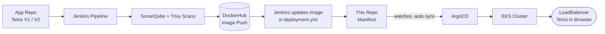

# 🎮 devsecops-Tetris-manifest

Kubernetes manifest repository for the **Tetris** game. This repo is the **GitOps source of truth**: Jenkins updates the image tag here after every successful build, and **ArgoCD** watches this repo and deploys the change to **AWS EKS** automatically.

> This repo contains **only manifests**. The application code lives in `devsecops-Tetris-V1` and `devsecops-tetris-v2`.

---

## 📐 How it works



1. Code is pushed to the app repo.
2. Jenkins runs scans, builds the Docker image and pushes it to DockerHub.
3. Jenkins edits the `image:` line in `deployment.yml` and commits it **to this repo**.
4. ArgoCD detects the commit and syncs it to the cluster.
5. Kubernetes performs a rolling update with the new image.

---

## 📁 Repository structure

```
.
├── deployment.yml   # Deployment + Service for Tetris
└── README.md
```

---

## 📄 What's in `deployment.yml`

### Deployment: `tetris`

| Setting | Value |
|---------|-------|
| Replicas | `3` |
| Label | `app: tetris` |
| Image | `vikasjagtap9696/tetrisv2:1` (updated automatically by Jenkins) |
| Container port | `3000` |

### Service: `tetris-service`

| Setting | Value |
|---------|-------|
| Type | `LoadBalancer` (creates an AWS ELB) |
| Service port | `80` |
| Target port | `3000` |
| Selector | `app: tetris` |

Traffic flow: `Browser → ELB:80 → Service:80 → Pod:3000`

---

## ⚠️ Do not edit the image tag manually

The line below is rewritten by the Jenkins pipeline using `sed`:

```yaml
image: vikasjagtap9696/tetrisv2:1
```

Jenkins runs:

```bash
sed -i "s|image: .*|image: <dockerhub-user>/tetrisv2:<BUILD_NUMBER>|" deployment.yml
```

If you edit it by hand, the next Jenkins run will overwrite it. To roll back, revert the commit in Git and ArgoCD will sync the old version.

---

## 🚀 Deploy with ArgoCD

### 1. Connect this repo

**ArgoCD → Settings → Repositories → Connect Repo Using HTTPS**

- Type: `git`
- Project: `default`
- URL: `https://github.com/vikasjagtap9696/devsecops-Tetris-manifest.git`

### 2. Create the application

| Field | Value |
|-------|-------|
| Application Name | `tetris` |
| Project | `default` |
| Sync Policy | `Automatic` |
| Repository URL | this repo's URL |
| Revision | `HEAD` |
| Path | `./` |
| Cluster URL | `https://kubernetes.default.svc` |
| Namespace | `default` |

Click **Create**. ArgoCD deploys the pods and creates the LoadBalancer.

### Manual deploy (without ArgoCD)

```bash
kubectl apply -f deployment.yml
```

---

## 🔍 Verify

```bash
kubectl get pods
kubectl get svc tetris-service
kubectl get all
```

Copy the `EXTERNAL-IP` (an `*.elb.amazonaws.com` hostname) of `tetris-service` and open it in your browser to play Tetris. The hostname can take a minute or two to become reachable.

---

## 🔄 Rolling out a new version

1. Push new code to the app repo.
2. Run the Jenkins pipeline (`TETRISV2`).
3. Jenkins commits the new image tag to this repo.
4. ArgoCD syncs, so check the ArgoCD UI for new pods.
5. Refresh the LoadBalancer URL.

---

## 🧹 Cleanup

```bash
kubectl delete -f deployment.yml
```

Then destroy the EKS cluster using the Jenkins `EKSJOB` pipeline with `action = destroy`, to avoid AWS charges.

---

## 🛠️ Related repositories

| Repo | Purpose |
|------|---------|
| `devsecops-Tetris-V1` | App v1 + Terraform for EKS |
| `devsecops-tetris-v2` | App v2 |
| `devsecops-Tetris-manifest` | **This repo**: Kubernetes manifests watched by ArgoCD |
